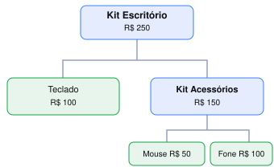

# PADRÕES DE PROJETOS
# 1. Definição

> "Descrever padrões de projeto é descrever comunicações de objetos e classes customizadas para resolver um problema geral de projeto em um contexto particular."  
> — Gamma, Helm, Johnson e Vlissides (Gang of Four, 1994).

Padrões de projeto são soluções gerais e reutilizáveis para problemas recorrentes de projeto de software. Não representam códigos prontos, mas modelos que podem ser adaptados a diferentes contextos.

Todo padrão do catálogo é descrito por quatro elementos essenciais:
- Nome: o termo que entra no vocabulário da equipe.
- Problema: a situação em que o padrão se aplica.
- Solução: os elementos participantes, suas responsabilidades e relações.
- Consequências: os custos e os benefícios da aplicação, incluindo o que se perde.

Portanto, um padrão só deve ser aplicado quando o problema, que ele se propõe a resolver, existe.

# 2. Tipos
## 2.1. Criacionais

> Como os objetos são criados?

São exemplos: Singleton, Factory Method, Abstract Factory, Builder e Prototype.

## 2.2. Estruturais

> Como os objetos se compõem?

São exemplos: Composite, Adapter, Decorator, Facade, Proxy, Bridge e Flyweight.

## 2.3. Comportamentais

> Como os objetos colaboram e distribuem responsabilidade?

São exemplos: Strategy, Observer, Template Method, Command, State, Iterator, Mediator, Memento, Chain of Responsibility, Visitor e Interpreter.

# 3. Strategy (comportamental)

| Critério | Strategy |
|:-:|---|
| **Categoria** | Comportamental |
| **Objetivo** | Encapsular diferentes algoritmos e permitir sua substituição sem alterar o código que os utiliza. |
| **Problema** | Diferentes algoritmos precisam ser utilizados por um mesmo contexto, sem que ele dependa diretamente de suas implementações. |
| **Quando usar** | Existem múltiplas implementações de uma mesma operação; os algoritmos variam independentemente; precisamos trocar comportamentos sem alterar o contexto. |
| **Quando não usar** | Existe apenas uma implementação; as regras são triviais e estáveis; a abstração introduziria mais complexidade do que benefícios. |
| **Vantagens** | Reduz acoplamento, favorece OCP, facilita testes isolados, reutilização e manutenção. |
| **Desvantagens** | Aumenta o número de classes; exige um mecanismo para selecionar a estratégia; pode gerar abstrações desnecessárias. |

Temos três componentes:
- **Strategy**: interface que define o comportamento esperado.
- **Concrete Strategies**: classes que implementam o comportamento esperado.
- **Context**: classe que mantém uma referência à Strategy e delega a ela a execução do algoritmo, sem depender de sua implementação concreta.

**Código sem aplicar o padrão:**
```c#
public class PedidoService
{
    public decimal CalcularFrete(string tipo, decimal peso)
    {
        if (tipo == "PAC")
        {
            return 15m;
        }
        else if (tipo == "SEDEX")
        {
            return 30m;
        }
        else if (tipo == "TRANSPORTADORA")
        {
            return peso * 2m;
        }

        throw new ArgumentException("Frete inválido: " + tipo);
    }
}
```
**Utilização:**
```c#
PedidoService pedido = new PedidoService();
decimal frete = pedido.CalcularFrete("SEDEX", 5m);
Console.WriteLine(frete);
```
**Console:**
```text
30
```

O padrão **Strategy** é adequado ao cálculo de frete porque existem diferentes modalidades (PAC, SEDEX e Transportadora), cada uma com sua própria regra de cálculo. Sem o padrão, o `PedidoService` concentra essas regras e utiliza condicionais para selecionar a modalidade. Com o Strategy, cada cálculo é encapsulado em uma classe que implementa a interface `IFreteStrategy`, reduzindo o acoplamento e facilitando a manutenção, os testes e a inclusão de novas modalidades sem modificar o `PedidoService`.

**Código após aplicar o padrão:**
```c#
// Strategy
public interface IFreteStrategy
{
    decimal Calcular(decimal peso);
}
//

// Concrete Strategies
public class FretePAC : IFreteStrategy
{
    public decimal Calcular(decimal peso)
    {
        return 15m;
    }
}

public class FreteSedex : IFreteStrategy
{
    public decimal Calcular(decimal peso)
    {
        return 30m;
    }
}

public class FreteTransportadora : IFreteStrategy
{
    public decimal Calcular(decimal peso)
    {
        return peso * 2m;
    }
}
//

// Context
public class PedidoService
{
    private readonly IFreteStrategy _frete;

    public PedidoService(IFreteStrategy frete)
    {
        _frete = frete;
    }

    public decimal CalcularFrete(decimal peso)
    {
        return _frete.Calcular(peso);
    }
}
//
```

**Utilização:**
```c#
PedidoService pedido = new PedidoService(new FreteSedex());
decimal frete = pedido.CalcularFrete(5m);
Console.WriteLine(frete);

pedido = new PedidoService(new FreteTransportadora());
frete = pedido.CalcularFrete(5m);
Console.WriteLine(frete);
```

**Console:**
```text
30
10
```

> **Ressalva**: ainda é necessário decidir qual estratégia instanciar. Em sistemas reais, essa decisão geralmente fica em uma Factory, na configuração de injeção de dependência ou em outra camada da aplicação.

# 4. Composite (estrutural)

| Critério | Composite |
|:-:|---|
| **Categoria** | Estrutural |
| **Objetivo** | Organizar objetos em estruturas hierárquicas e permitir que objetos individuais e composições sejam tratados uniformemente. |
| **Problema** | Objetos simples e compostos precisam participar das mesmas operações, mas suas diferenças estruturais dificultam o tratamento uniforme pelo código cliente. |
| **Quando usar** | Quando os objetos formam estruturas hierárquicas (árvores), com elementos que podem conter outros elementos, e precisam ser manipulados por uma interface comum. |
| **Quando não usar** | Quando não existe uma relação hierárquica adequada, os elementos possuem comportamentos incompatíveis ou uma estrutura simples não justifica a abstração. |
| **Vantagens** | Simplifica o código cliente, reduz acoplamento, facilita estruturas recursivas e favorece a extensão com novos componentes. |
| **Desvantagens** | Pode dificultar a imposição de restrições entre componentes, introduzir recursividade complexa e exigir interfaces excessivamente genéricas. |

Temos três componentes:
- **Component**: interface que define as operações comuns aos objetos individuais e compostos.
- **Leaf**: objeto individual que não possui filhos e implementa diretamente as operações.
- **Composite**: objeto que contém outros componentes e implementa as operações, geralmente delegando sua execução aos filhos.

**Exemplo: Produtos e Kits de Produtos**

Imagine um sistema de vendas que comercializa produtos individuais e kits. Cada kit pode conter produtos e outros kits, formando uma estrutura hierárquica. Precisamos calcular o preço total de qualquer produto ou kit.



**Código sem aplicar o padrão:**

```csharp
public class Produto
{
    public decimal Preco { get; set; }
}

public class Kit
{
    public List<Produto> Produtos { get; } = new();
    public List<Kit> Subkits { get; } = new();
}

public class CalculadoraPreco
{
    public decimal Calcular(Kit kit)
    {
        decimal total = 0;

        foreach (var produto in kit.Produtos)
        {
            total += produto.Preco;
        }

        foreach (var subkit in kit.Subkits)
        {
            total += Calcular(subkit);
        }

        return total;
    }
}
```

**Utilização:**

```csharp
var escritorio = new Kit();
var acessorios = new Kit();

escritorio.Produtos.Add(new Produto { Preco = 100 });

acessorios.Produtos.Add(new Produto { Preco = 50 });
acessorios.Produtos.Add(new Produto { Preco = 100 });

escritorio.Subkits.Add(acessorios);

var calculadora = new CalculadoraPreco();

Console.WriteLine(calculadora.Calcular(escritorio));
```

**Console:**

```text
250
```

O padrão **Composite** é adequado ao sistema de vendas porque produtos e kits formam uma estrutura hierárquica, na qual um kit pode conter produtos individuais e outros kits. Sem o padrão, essas entidades possuem interfaces diferentes, exigindo que o código responsável pelo cálculo conheça suas estruturas. Com o Composite, ambos implementam a interface `IItemVenda`, permitindo calcular seus preços de maneira uniforme. Cada produto retorna seu próprio preço, enquanto cada kit soma recursivamente os preços de seus componentes, reduzindo o acoplamento e facilitando a extensão da estrutura.

**Código após aplicar o padrão:**

```csharp
// Component
public interface IItemVenda
{
    decimal CalcularPreco();
}
//

// Leaf
public class Produto : IItemVenda
{
    public decimal Preco { get; set; }

    public decimal CalcularPreco()
    {
        return Preco;
    }
}
//

// Composite
public class Kit : IItemVenda
{
    private readonly List<IItemVenda> _itens = new();

    public void Adicionar(IItemVenda item)
    {
        _itens.Add(item);
    }

    public decimal CalcularPreco()
    {
        decimal total = 0;

        foreach (var item in _itens)
        {
            total += item.CalcularPreco();
        }

        return total;
    }
}
//
```

**Utilização:**

```csharp
var escritorio = new Kit();
var acessorios = new Kit();

escritorio.Adicionar(new Produto { Preco = 100 });

acessorios.Adicionar(new Produto { Preco = 50 });
acessorios.Adicionar(new Produto { Preco = 100 });

escritorio.Adicionar(acessorios);

Console.WriteLine(escritorio.CalcularPreco());
Console.WriteLine(acessorios.CalcularPreco());
```

**Console:**

```text
250
150
```

> **Ressalva**: o Composite não consiste apenas em armazenar objetos em uma coleção. Sua característica principal é permitir que elementos individuais e compostos sejam tratados por uma interface comum, geralmente em uma estrutura recursiva. Também é importante controlar quais componentes podem conter filhos, impedir referências circulares na hierarquia e evitar a contagem duplicada de componentes compartilhados quando isso não fizer sentido para o domínio.

# 5. Factory Method (criacional)

| Critério | Factory Method |
|:-:|---|
| **Categoria** | Criacional |
| **Objetivo** | Definir um método para criação de objetos, permitindo que subclasses determinem quais implementações concretas serão instanciadas. |
| **Problema** | Uma classe precisa criar e utilizar objetos cujas implementações podem variar, sem depender diretamente de suas classes concretas. |
| **Quando usar** | Quando subclasses precisam personalizar a criação de objetos utilizados em um processo comum, especialmente em frameworks, bibliotecas e estruturas extensíveis baseadas em herança. |
| **Quando não usar** | Quando a criação é simples, não há necessidade de especialização por subclasses ou a composição e a injeção de dependência oferecem uma solução mais simples. |
| **Vantagens** | Reduz acoplamento, favorece OCP, permite reutilizar processos comuns e facilita a extensão com novos tipos de objetos. |
| **Desvantagens** | Aumenta o número de classes, introduz herança, exige escolher qual classe criadora utilizar e pode adicionar complexidade desnecessária. |

Temos quatro componentes:
- **Product**: interface ou classe base que define o contrato dos objetos criados.
- **Concrete Product**: classes que implementam o contrato do Product.
- **Creator**: classe que declara o Factory Method e pode conter operações que utilizam os objetos criados.
- **Concrete Creator**: subclasses que implementam ou sobrescrevem o Factory Method, determinando quais objetos serão instanciados.

## 5.1. Exemplo: Exportação de arquivos

Imagine que estamos desenvolvendo uma biblioteca para exportar produtos de um ERP.

O processo de exportação é sempre o mesmo:

1. Criar o arquivo de destino.
2. Escrever o cabeçalho.
3. Escrever os produtos.
4. Finalizar e fechar o arquivo.

Entretanto, precisamos disponibilizar duas formas de exportação:
- **CSV**: arquivo de texto convencional (`produtos.csv`).
- **CSV compactado**: arquivo compactado utilizando GZIP (`produtos.csv.gz`).

Independentemente do formato escolhido, o processo de escrita dos produtos é o mesmo. O que muda é a maneira como o arquivo de destino é criado.

### 5.1.1. Código sem aplicar o padrão

```csharp
using System.IO;
using System.IO.Compression;

public class ExportadorCsv
{
    public void Exportar(
        string nome,
        IEnumerable<string> produtos,
        string formato)
    {
        Stream destino;

        if (formato == "CSV")
        {
            destino = File.Create($"{nome}.csv");
        }
        else if (formato == "GZIP")
        {
            var arquivo = File.Create($"{nome}.csv.gz");

            destino = new GZipStream(
                arquivo,
                CompressionLevel.Optimal
            );
        }
        else
        {
            throw new ArgumentException("Formato inválido");
        }

        using (destino)
        using (var writer = new StreamWriter(destino))
        {
            writer.WriteLine("Produto");

            foreach (var produto in produtos)
            {
                writer.WriteLine(produto);
            }
        }
    }
}
```

**Utilização:**

```csharp
var produtos = new[] { "Teclado", "Mouse", "Monitor" };

var exportador = new ExportadorCsv();

exportador.Exportar("produtos", produtos, "CSV");
exportador.Exportar("produtos", produtos, "GZIP");
```

**Resultado:**

```text
produtos.csv
produtos.csv.gz
```

O código funciona, mas a classe `ExportadorCsv` conhece diretamente todas as formas de criação dos arquivos. Se precisarmos adicionar outro tipo de destino, será necessário modificar essa classe, mesmo que o processo de exportação continue o mesmo.

### 5.1.2. Por que usar Factory Method?

O padrão **Factory Method** é adequado quando queremos disponibilizar um processo comum de exportação, permitindo que diferentes subclasses personalizem a criação dos arquivos. Sem o padrão, a classe `ExportadorCsv` concentra tanto o processo de escrita quanto a escolha e a criação do destino. Com o Factory Method, a classe base mantém o processo de exportação e delega às subclasses a responsabilidade pela criação do `Stream`, permitindo adicionar novas formas de armazenamento sem modificar o fluxo existente.

### 5.1.3. Código após aplicar o padrão

Neste exemplo, utilizaremos a própria classe `Stream` do .NET como Product. As classes concretas utilizadas serão `FileStream`, criado por `File.Create()`, e `GZipStream`.

**Creator:**

```csharp
public abstract class ExportadorCsv
{
    // Factory Method
    protected abstract Stream CriarDestino(string nome);

    public void Exportar(
        string nome,
        IEnumerable<string> produtos)
    {
        using Stream destino = CriarDestino(nome);
        using var writer = new StreamWriter(destino);

        writer.WriteLine("Produto");

        foreach (var produto in produtos)
        {
            writer.WriteLine(produto);
        }
    }
}
```

Observe que `Exportar()` conhece todas as etapas do processo, mas não sabe qual implementação de `Stream` será criada.

**Concrete Creators:**

```csharp
public class ExportadorArquivo : ExportadorCsv
{
    protected override Stream CriarDestino(string nome)
    {
        return File.Create($"{nome}.csv");
    }
}

public class ExportadorCompactado : ExportadorCsv
{
    protected override Stream CriarDestino(string nome)
    {
        var arquivo = File.Create($"{nome}.csv.gz");

        return new GZipStream(
            arquivo,
            CompressionLevel.Optimal
        );
    }
}
```

**Utilização:**

```csharp
var produtos = new[] { "Teclado", "Mouse", "Monitor" };

ExportadorCsv exportador = new ExportadorArquivo();
exportador.Exportar("produtos", produtos);

exportador = new ExportadorCompactado();
exportador.Exportar("produtos", produtos);
```

**Resultado:**

```text
produtos.csv
produtos.csv.gz
```

Agora, caso precisemos adicionar uma nova forma de armazenamento, podemos criar outra subclasse de `ExportadorCsv`, implementando apenas `CriarDestino()`.

O processo de exportação continua centralizado na classe base e não precisa ser modificado.

## 5.2. Factory Method x Injeção de Dependência

Uma dúvida importante é: **por que utilizar Factory Method em vez de injeção de dependência?**

Poderíamos implementar `ExportadorCsv` recebendo diretamente um `Stream` pelo construtor:

```csharp
public class ExportadorCsv
{
    private readonly Stream _destino;

    public ExportadorCsv(Stream destino)
    {
        _destino = destino;
    }
}
```

Entretanto, cada exportação precisa criar um novo arquivo, utilizando o nome informado na chamada, e fechá-lo quando terminar.

Injetar um único `Stream` não representa tão bem esse ciclo de vida, pois o objeto já existe antes da exportação e pode não ser reutilizável.

Com Factory Method, a criação acontece dentro de cada execução:

```csharp
protected abstract Stream CriarDestino(string nome);
```

Assim, cada chamada de `Exportar()` cria seu próprio destino.

**Mas existe outra alternativa:** em vez de injetar o objeto pronto, podemos injetar uma fábrica responsável por criá-lo.

Em C#, poderíamos utilizar `Func<string, Stream>`:

```csharp
public class ExportadorCsv
{
    private readonly Func<string, Stream> _criarDestino;

    public ExportadorCsv(Func<string, Stream> criarDestino)
    {
        _criarDestino = criarDestino;
    }

    public void Exportar(
        string nome,
        IEnumerable<string> produtos)
    {
        using Stream destino = _criarDestino(nome);
        using var writer = new StreamWriter(destino);

        writer.WriteLine("Produto");

        foreach (var produto in produtos)
        {
            writer.WriteLine(produto);
        }
    }
}
```

**Utilização:**

```csharp
var produtos = new[] { "Teclado", "Mouse", "Monitor" };

var exportador = new ExportadorCsv(
    nome => File.Create($"{nome}.csv")
);

exportador.Exportar("produtos", produtos);
```

Essa abordagem também resolve o problema, sem exigir subclasses de `ExportadorCsv`.

Portanto, **Factory Method não é necessariamente melhor que injeção de dependência**. A escolha depende de como o sistema foi estruturado e de quem deve ser responsável pela criação dos objetos.

| Factory Method | Injeção de fábrica |
|---|---|
| Utiliza herança e sobrescrita de métodos. | Utiliza composição e injeção de dependência. |
| A subclasse decide qual objeto criar. | Uma dependência externa determina como criar o objeto. |
| Adequado quando subclasses já representam variações do processo. | Adequado quando queremos configurar dependências sem criar subclasses. |
| A criação é personalizada por meio de um método sobrescrito. | A criação é delegada a uma função ou objeto fábrica. |

### 5.2.1. Quando Factory Method realmente vale a pena?

O Factory Method se torna especialmente interessante em **frameworks, bibliotecas extensíveis e sistemas que utilizam herança para especializar comportamentos**.

Imagine que estamos desenvolvendo um framework que fornece uma classe base responsável por executar um processo completo. Outros desenvolvedores precisam estender essa classe, mas cada implementação utiliza objetos diferentes.

Nesse cenário, podemos manter o processo principal na classe base e disponibilizar um Factory Method para que as subclasses personalizem apenas a criação dos objetos necessários.

Assim, o benefício não está simplesmente em substituir condicionais por polimorfismo, mas em **fornecer um ponto de extensão para a criação de objetos sem modificar o processo que os utiliza**.

Por outro lado, quando precisamos apenas fornecer diferentes implementações de uma interface, a composição e a injeção de dependência geralmente são alternativas mais simples.

> **Ressalva:** o Factory Method não elimina a necessidade de escolher qual `Concrete Creator` instanciar. Além disso, não devemos utilizá-lo apenas para substituir condicionais por subclasses. Seu principal benefício aparece quando precisamos permitir que subclasses personalizem a criação de objetos dentro de um processo comum. Se não existe necessidade de extensão por herança, a injeção de dependência pode ser uma solução mais adequada.

**Conclusão:** antes de aplicar Factory Method, devemos nos perguntar: *preciso que subclasses determinem quais objetos serão criados, enquanto a classe base continua responsável por um processo comum?* Se sim, o padrão é um candidato. Caso contrário, vale avaliar soluções mais simples, principalmente a composição e a injeção de dependência.

# 6. Singleton (criacional)

| Critério | Singleton |
|:-:|---|
| **Categoria** | Criacional |
| **Objetivo** | Garantir que uma classe possua uma única instância em um determinado contexto de execução e fornecer um ponto global de acesso a ela. |
| **Problema** | Diferentes partes do sistema precisam compartilhar uma mesma instância, mantendo seu estado e evitando a criação independente de objetos que deveriam representar o mesmo recurso. |
| **Quando usar** | Quando é necessário garantir uma única instância em um escopo definido e disponibilizar seu acesso a diferentes partes do sistema. |
| **Quando não usar** | Quando os objetos não precisam compartilhar estado, podem existir múltiplas instâncias ou o gerenciamento de instâncias pode ser realizado de forma mais adequada por injeção de dependência. |
| **Vantagens** | Controla a quantidade de instâncias, permite compartilhar estado e pode adiar a criação do objeto até sua primeira utilização. |
| **Desvantagens** | Introduz estado global, aumenta o acoplamento, dificulta testes isolados e pode gerar problemas de concorrência e gerenciamento do ciclo de vida. |

O Singleton possui três características principais:
- **Construtor privado**: impede que outras classes criem instâncias diretamente.
- **Instância única**: uma referência estática mantém o objeto compartilhado.
- **Ponto de acesso global**: disponibiliza um método ou propriedade para recuperar a instância.

## 6.1. Exemplo: Fila de impressão de documentos

Imagine um ERP que possui diferentes módulos, como Vendas, Faturamento e Estoque.

Todos precisam enviar documentos para uma mesma fila de impressão, de modo que um serviço centralizado possa processá-los.

**[INSERIR AQUI O SVG DO SINGLETON]**

### 6.1.1. Código sem aplicar o padrão

```csharp
public class FilaImpressao
{
    private readonly Queue<string> _documentos = new();

    public void Adicionar(string documento)
    {
        _documentos.Enqueue(documento);
    }

    public int Quantidade()
    {
        return _documentos.Count;
    }
}
```

**Utilização:**

```csharp
// Módulo de Vendas
var filaVendas = new FilaImpressao();
filaVendas.Adicionar("Pedido 123");

// Módulo de Faturamento
var filaFaturamento = new FilaImpressao();

Console.WriteLine(filaVendas.Quantidade());
Console.WriteLine(filaFaturamento.Quantidade());
```

**Console:**

```text
1
0
```

Observe que cada módulo criou sua própria instância de `FilaImpressao`.

Consequentemente, os documentos adicionados por Vendas não estão disponíveis na fila utilizada pelo Faturamento.

Precisamos garantir que ambos utilizem a mesma instância.

### 6.1.2. Por que usar Singleton?

O padrão **Singleton** é adequado ao gerenciamento da fila de impressão porque diferentes módulos precisam compartilhar uma mesma instância e seu estado. Sem o padrão, cada módulo pode criar uma fila independente, fragmentando os documentos pendentes. Com o Singleton, a criação da instância é controlada pela própria classe, garantindo que todos os módulos que utilizam seu ponto de acesso compartilhem a mesma fila dentro do processo, centralizando seu gerenciamento.

### 6.1.3. Código após aplicar o padrão

```csharp
using System.Collections.Concurrent;

public sealed class FilaImpressao
{
    // Instância única, criada sob demanda
    private static readonly Lazy<FilaImpressao> _instancia =
        new(() => new FilaImpressao());

    // Ponto de acesso global
    public static FilaImpressao Instancia => _instancia.Value;

    // Fila segura para acessos concorrentes
    private readonly ConcurrentQueue<string> _documentos = new();

    // Construtor privado
    private FilaImpressao()
    {
    }

    public void Adicionar(string documento)
    {
        _documentos.Enqueue(documento);
    }

    public int Quantidade()
    {
        return _documentos.Count;
    }

    public string? Proximo()
    {
        return _documentos.TryDequeue(out var documento)
            ? documento
            : null;
    }
}
```

**Utilização:**

```csharp
// Módulo de Vendas
var filaVendas = FilaImpressao.Instancia;
filaVendas.Adicionar("Pedido 123");

// Módulo de Faturamento
var filaFaturamento = FilaImpressao.Instancia;
filaFaturamento.Adicionar("Nota Fiscal 456");

Console.WriteLine(filaVendas.Quantidade());
Console.WriteLine(filaFaturamento.Quantidade());

Console.WriteLine(
    ReferenceEquals(filaVendas, filaFaturamento)
);

Console.WriteLine(filaFaturamento.Proximo());
```

**Console:**

```text
2
2
True
Pedido 123
```

Agora, os dois módulos utilizam a mesma instância de `FilaImpressao`.

A propriedade estática `Instancia` sempre retorna o mesmo objeto, independentemente de qual módulo a acessa.

## 6.2. Entendendo a implementação

**Construtor privado:**

```csharp
private FilaImpressao()
{
}
```

Impede que outras classes utilizem `new FilaImpressao()`, controlando a criação de instâncias pelos caminhos convencionais.

**Instância estática:**

```csharp
private static readonly Lazy<FilaImpressao> _instancia =
    new(() => new FilaImpressao());
```

O `Lazy<T>` permite que a instância seja criada somente quando necessária (*lazy initialization*).

Além disso, seu comportamento padrão garante que a inicialização seja segura para acessos concorrentes entre threads.

**Ponto global de acesso:**

```csharp
public static FilaImpressao Instancia => _instancia.Value;
```

Permite que qualquer módulo obtenha a instância compartilhada.

**Controle de concorrência:**

```csharp
private readonly ConcurrentQueue<string> _documentos = new();
```

O Singleton garante uma única instância, mas não torna automaticamente suas operações seguras para múltiplas threads. Por isso, utilizamos `ConcurrentQueue<T>` para proteger as operações da fila.

## 6.3. Singleton x Injeção de Dependência

Embora o Singleton resolva o problema do exemplo, em aplicações modernas com .NET, especialmente ASP.NET Core, geralmente é preferível utilizar o gerenciamento de dependências do próprio framework.

Podemos registrar uma classe como Singleton:

```csharp
builder.Services.AddSingleton<FilaImpressao>();
```

Nesse caso, `FilaImpressao` pode ser uma classe convencional com construtor público, sem precisar implementar a propriedade estática `Instancia`.

As classes que precisam da fila recebem a instância pelo construtor:

```csharp
public class PedidoService
{
    private readonly FilaImpressao _fila;

    public PedidoService(FilaImpressao fila)
    {
        _fila = fila;
    }

    public void ImprimirPedido()
    {
        _fila.Adicionar("Pedido 123");
    }
}
```

O contêiner de injeção de dependência garante que os serviços resolvidos pelo mesmo `ServiceProvider` compartilhem aquela instância registrada.

| Singleton tradicional | Singleton via injeção de dependência |
|---|---|
| A própria classe controla sua instância. | O contêiner controla a instância. |
| Utiliza um ponto estático de acesso global. | A instância é recebida como dependência. |
| Cria dependência direta do acesso global. | Torna a dependência explícita no construtor. |
| Pode dificultar testes e substituições. | Facilita testes com implementações alternativas. |
| O ciclo de vida é controlado pela implementação estática. | O ciclo de vida é gerenciado pelo contêiner. |

### 6.3.1. Quando Singleton realmente vale a pena?

O Singleton tradicional pode fazer sentido quando precisamos controlar uma instância única em uma aplicação sem contêiner de dependências, ou quando uma biblioteca precisa oferecer um ponto de acesso compartilhado e esse contrato faz parte de seu projeto.

Entretanto, **não devemos utilizar Singleton apenas porque um objeto é muito utilizado ou porque queremos evitar a criação de novas instâncias**.

Em aplicações que já utilizam injeção de dependência, normalmente é mais adequado registrar o serviço com ciclo de vida Singleton, preservando a possibilidade de substituí-lo e testá-lo isoladamente.

> **Ressalva:** a unicidade do Singleton tradicional normalmente está limitada ao processo e ao contexto de carregamento em que a classe existe. Em aplicações distribuídas ou com múltiplas instâncias de servidor, cada processo pode possuir seu próprio Singleton. Portanto, ele não garante uma instância única para todo o sistema distribuído. No exemplo da fila de impressão, uma aplicação distribuída provavelmente precisaria de uma fila externa compartilhada, como um serviço de mensageria.

**Conclusão:** antes de aplicar Singleton, devemos nos perguntar: *preciso realmente garantir uma única instância compartilhada, ou apenas disponibilizar o mesmo serviço para diferentes partes da aplicação?* No primeiro caso, Singleton pode ser adequado. No segundo, vale considerar a injeção de dependência com gerenciamento de ciclo de vida.

# 7. MVC (padrão arquitetural)

O **MVC (Model-View-Controller)** é um padrão arquitetural que separa uma aplicação interativa em três responsabilidades: **Modelo**, **Visão** e **Controlador**. Seu objetivo é permitir que a interface, as regras de negócio e a coordenação das ações evoluam com menor acoplamento.

> **Importante:** o MVC não pertence ao catálogo de padrões de projeto do GoF. Ele trata da organização da aplicação, enquanto Strategy, Composite, Factory Method e Singleton tratam de problemas mais específicos entre classes e objetos.

| Critério | MVC |
|:-:|---|
| **Categoria** | Arquitetural (apresentação e interação). |
| **Objetivo** | Separar dados e regras de domínio, apresentação e coordenação das ações do usuário. |
| **Problema** | A interface, as decisões de interação e as regras de negócio ficam misturadas, dificultando alterações, testes e reutilização. |
| **Quando usar** | Quando a aplicação possui interação com usuários e a separação entre apresentação, coordenação e domínio melhora sua manutenção e evolução. |
| **Quando não usar** | Quando a aplicação é muito pequena e a divisão em camadas introduz mais complexidade do que benefícios, ou quando outra arquitetura atende melhor ao tipo de interface. |
| **Vantagens** | Separa responsabilidades, localiza mudanças, facilita testes, reutilização do domínio e substituição de interfaces. |
| **Desvantagens** | Introduz classes e dependências adicionais; exige disciplina para evitar controladores com regras de negócio e camadas excessivamente acopladas. |

Temos três componentes:
- **Model (Modelo)**: representa o estado e as regras do domínio. Não deve depender da forma como as informações serão exibidas.
- **View (Visão)**: apresenta informações ao usuário e recebe suas entradas. Não é responsável por executar as regras do domínio.
- **Controller (Controlador)**: interpreta as ações do usuário, aciona o Modelo e coordena a resposta apresentada pela Visão.

Na **variação didática utilizada nesta aula**, o Controlador conhece a Visão e o Modelo, enquanto essas duas camadas não se referenciam diretamente.

**[INSERIR AQUI O SVG DO FLUXO MVC]**

## 7.1. Exemplo: Jogo de um arqueiro

Imagine um jogo de console no qual um personagem pode atacar, defender ou consultar suas informações. A interface recebe a opção digitada, o personagem executa as regras e uma mensagem é apresentada ao usuário.

### 7.1.1. Código sem aplicar o padrão

```csharp
public class JogoSemCamadas
{
    private readonly string _nome = "Anderson";

    public void Executar()
    {
        bool continuar = true;

        while (continuar)
        {
            Console.WriteLine("1 - Atacar");
            Console.WriteLine("2 - Defender");
            Console.WriteLine("3 - Sair");
            int opcao = int.Parse(Console.ReadLine()!);

            if (opcao == 1)
            {
                Console.WriteLine($"{_nome} está atacando com arco...");
                File.AppendAllText("log_jogo.txt", $"Atacou - {DateTime.Now}\n");
            }
            else if (opcao == 2)
            {
                Console.WriteLine($"{_nome} está defendendo com escudo...");
            }
            else if (opcao == 3)
            {
                continuar = false;
            }
        }
    }
}
```

**Utilização:**

```csharp
new JogoSemCamadas().Executar();
```

**Console (exemplo de interação):**

```text
1 - Atacar
2 - Defender
3 - Sair
1
Anderson está atacando com arco...
```

Essa classe concentra responsabilidades diferentes: apresenta o menu, lê o teclado, decide qual ação executar, contém a regra do ataque e grava o log. Se a interface for substituída por uma página web ou janela, será preciso alterar código que também contém regras do jogo. Além disso, testar o comportamento depende da execução do menu.

### 7.1.2. Por que usar MVC?

O **MVC** é adequado porque a interface, as regras do personagem e o controle das ações possuem motivos diferentes para mudar. Sem o padrão, essas responsabilidades ficam concentradas na mesma classe. Com o MVC, o **Modelo** executa as ações do arqueiro, a **Visão** recebe e apresenta informações e o **Controlador** coordena o fluxo entre ambos. Assim, mudanças na apresentação não precisam modificar as regras do personagem, e as regras podem ser testadas separadamente.

### 7.1.3. Código após aplicar o padrão

**Model — interfaces e implementações das armas:**

```csharp
// Model: contratos
public interface IArmaAtaque
{
    string Atacar(string nome);
}

public interface IArmaDefesa
{
    string Defender(string nome);
}

// Model: implementações
public class Arco : IArmaAtaque
{
    public string Atacar(string nome)
    {
        return $"{nome} está atacando com arco...";
    }
}

public class Escudo : IArmaDefesa
{
    public string Defender(string nome)
    {
        return $"{nome} está defendendo com escudo...";
    }
}

// Model: personagem e regras do domínio
public class Arqueiro
{
    private readonly string _nome;
    private readonly IArmaAtaque _ataque;
    private readonly IArmaDefesa _defesa;

    public Arqueiro(string nome, IArmaAtaque ataque, IArmaDefesa defesa)
    {
        _nome = nome;
        _ataque = ataque;
        _defesa = defesa;
    }

    public string Atacar() => _ataque.Atacar(_nome);
    public string Defender() => _defesa.Defender(_nome);
    public override string ToString() => $"{_nome} - Arqueiro";
}
```

O `Arqueiro` não escreve no console e não conhece o menu. Ele executa operações do domínio e devolve seus resultados. As armas são recebidas por injeção de dependência, permitindo aplicar **Strategy** sem modificar o personagem.

**View — entrada e apresentação:**

```csharp
public class JogoVisao
{
    public int Menu()
    {
        Console.WriteLine("1 - Atacar");
        Console.WriteLine("2 - Defender");
        Console.WriteLine("3 - Informações");
        Console.WriteLine("4 - Sair");

        return int.Parse(Console.ReadLine()!);
    }

    public void RenderizaMensagem(string mensagem)
    {
        Console.WriteLine(mensagem);
    }
}
```

A Visão sabe **como** receber uma opção e exibir uma mensagem, mas não sabe o significado da opção nem como funciona o ataque.

**Controller — coordenação do fluxo:**

```csharp
public class JogoControlador
{
    private readonly JogoVisao _visao;
    private readonly Arqueiro _arqueiro;

    public JogoControlador(JogoVisao visao, Arqueiro arqueiro)
    {
        _visao = visao;
        _arqueiro = arqueiro;
    }

    public void ExecutarJogo()
    {
        bool continuar = true;

        while (continuar)
        {
            int opcao = _visao.Menu();

            switch (opcao)
            {
                case 1:
                    _visao.RenderizaMensagem(_arqueiro.Atacar());
                    break;
                case 2:
                    _visao.RenderizaMensagem(_arqueiro.Defender());
                    break;
                case 3:
                    _visao.RenderizaMensagem(_arqueiro.ToString());
                    break;
                case 4:
                    continuar = false;
                    break;
                default:
                    _visao.RenderizaMensagem("Opção inválida!");
                    break;
            }
        }
    }
}
```

O Controlador interpreta a opção escolhida, mas **não implementa as regras de ataque ou defesa**. Essas regras continuam no Modelo.

**Utilização — `Program.cs` (ponto de composição):**

```csharp
IArmaAtaque arco = new Arco();
IArmaDefesa escudo = new Escudo();

var arqueiro = new Arqueiro("Anderson", arco, escudo);
var visao = new JogoVisao();
var controlador = new JogoControlador(visao, arqueiro);

controlador.ExecutarJogo();
```

**Console (exemplo de interação):**

```text
1 - Atacar
2 - Defender
3 - Informações
4 - Sair
1
Anderson está atacando com arco...
```

> **Simplificação do exemplo:** o material original também injeta um `Logger` no Controlador e usa um Singleton no Modelo. O código acima omite o log para destacar a separação MVC. Da mesma forma que na aula, o menu usa `int.Parse()` sem validação; em um sistema real, seria preferível tratar entradas inválidas com `int.TryParse()`.

## 7.2. Fluxo de uma ação

Quando o usuário seleciona **1 — Atacar**, ocorre a seguinte sequência:

1. **View:** `JogoVisao.Menu()` lê a opção e devolve `1`.
2. **Controller:** `JogoControlador` interpreta a opção como uma solicitação de ataque.
3. **Model:** `Arqueiro.Atacar()` aplica o comportamento do personagem e delega à arma escolhida.
4. **Controller:** recebe o resultado da operação.
5. **View:** `RenderizaMensagem()` apresenta a mensagem ao usuário.

**[INSERIR AQUI O DIAGRAMA DE SEQUÊNCIA MVC]**

O fluxo pode ser resumido como: **Usuário → Visão → Controlador → Modelo → Controlador → Visão → Usuário**.

## 7.3. Onde cada mudança deve acontecer?

| Mudança desejada | Camada responsável | O que tende a permanecer inalterado |
|---|---|---|
| Alterar textos, menu ou formatação das mensagens | View | Regras do Model |
| Modificar as regras de ataque | Model | View e Controller |
| Trocar o arco por uma espada | Composição no `Program.cs`, utilizando outra estratégia | `Arqueiro`, View e Controller |
| Alterar a sequência de ações após uma escolha | Controller | Regras internas do Model |
| Substituir o console por outra interface | View e montagem da aplicação | Regras de domínio |
| Adicionar a ação **Descansar** | Pode exigir mudanças nas três camadas | Cada responsabilidade continua no seu lugar |

**O MVC localiza as mudanças, mas não as elimina.** Uma funcionalidade nova pode exigir alterações no Modelo, na Visão e no Controlador. O benefício é saber onde cada responsabilidade deve ficar.

## 7.4. Violações comuns do MVC

**1. A Visão executa regras ou decide ações do domínio:**

```csharp
// Evitar: a View passa a decidir a ação do personagem.
if (opcao == 1)
{
    Console.WriteLine(_arqueiro.Atacar());
}
```

No modelo de MVC utilizado nesta aula, essa decisão pertence ao Controlador. Caso contrário, ela precisará ser repetida ao substituir a interface.

**2. O Controlador concentra regras de negócio:**

```csharp
// Evitar: regra do jogo dentro do Controller.
bool esquivou = new Random().Next(0, 2) == 1;
if (esquivou)
{
    _visao.RenderizaMensagem("Esquivou e atacou!");
}
```

A regra de esquiva pertence ao domínio, não à coordenação da interação. Um Controller com muitos cálculos, condições e decisões de negócio tende a ficar excessivamente complexo (*fat controller*).

**3. O Modelo decide como apresentar informações:**

```csharp
// Evitar: o Model fica acoplado à interface de console.
public string Atacar()
{
    Console.WriteLine("Atacando...");
    return _ataque.Atacar(_nome);
}
```

O Modelo deve devolver o resultado da operação; a Visão decide como apresentá-lo.

**4. Criar três pastas e considerar a aplicação MVC:**

Criar pastas `Modelo`, `Visao` e `Controlador` não garante separação de responsabilidades. O que importa é **como as classes dependem umas das outras e onde as regras são implementadas**.

## 7.5. MVC e outros padrões

| Padrão ou técnica | Aplicação no exemplo |
|---|---|
| **Strategy** | O `Arqueiro` utiliza `IArmaAtaque` e `IArmaDefesa`, permitindo variar armas sem alterar a classe do personagem. |
| **Singleton** | Um `Logger` compartilhado pode atender diferentes componentes, como no projeto da aula. |
| **Injeção de dependência** | `Arqueiro` e `JogoControlador` recebem suas dependências pelo construtor. |
| **Factory Method** | Pode permitir que subclasses especializem a criação de armas sem alterar o fluxo que as utiliza. |
| **Composite** | Pode representar combinações de ataques por uma interface comum, tratando ataques simples e compostos uniformemente. |

**MVC não substitui esses padrões.** Ele organiza as responsabilidades da aplicação; os demais resolvem problemas específicos de criação, composição e comportamento dentro dessa arquitetura.

## 7.6. MVC no ASP.NET Core

A separação também aparece em aplicações web, mas as tecnologias mudam:

| Responsabilidade | Exemplo em console | Exemplo em ASP.NET Core MVC |
|---|---|---|
| **View** | `JogoVisao`, com `Console.WriteLine()` | Arquivos Razor `.cshtml` |
| **Controller** | `JogoControlador` | Classes `Controller` e seus métodos de ação |
| **Model** | `Arqueiro` e classes das armas | Entidades de domínio, regras e serviços |
| **Ponto de composição** | `Program.cs`, criando objetos manualmente | `Program.cs` e contêiner de injeção de dependência |

**Atenção à variação do MVC:** a regra de que a View não conhece o Model descreve a versão didática adotada no PDF. Ela **não é universal**: no ASP.NET Core MVC, por exemplo, uma View pode receber um modelo de apresentação fortemente tipado (`@model`). O princípio essencial permanece sendo separar responsabilidades e evitar que a apresentação concentre regras do domínio.

## 7.7. Quando realmente vale a pena?

O MVC é especialmente útil quando a aplicação apresenta **interfaces e regras de negócio que precisam evoluir separadamente**. Ele tende a facilitar manutenção, testes e a troca de tecnologias de apresentação.

Entretanto, separar tudo em camadas não garante qualidade. Um sistema pequeno pode ficar desnecessariamente complexo, e um Controller que concentra regras de negócio continua sendo problemático mesmo dentro de uma estrutura chamada MVC.

> **Ressalva:** o MVC não exige uma estrutura física específica de pastas nem resolve automaticamente o acoplamento. O padrão depende da correta distribuição de responsabilidades. Também não impede que uma funcionalidade envolva mudanças em todas as camadas.

**Conclusão:** antes de aplicar MVC, devemos nos perguntar: *a separação entre apresentação, coordenação e domínio ajudará a manter e evoluir esta aplicação?* Se sim, MVC é um candidato. O principal objetivo não é aumentar o número de classes, mas garantir que **cada responsabilidade esteja no lugar adequado**.
